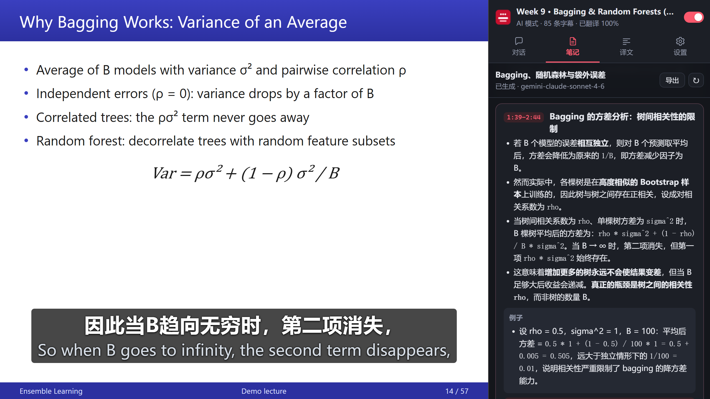
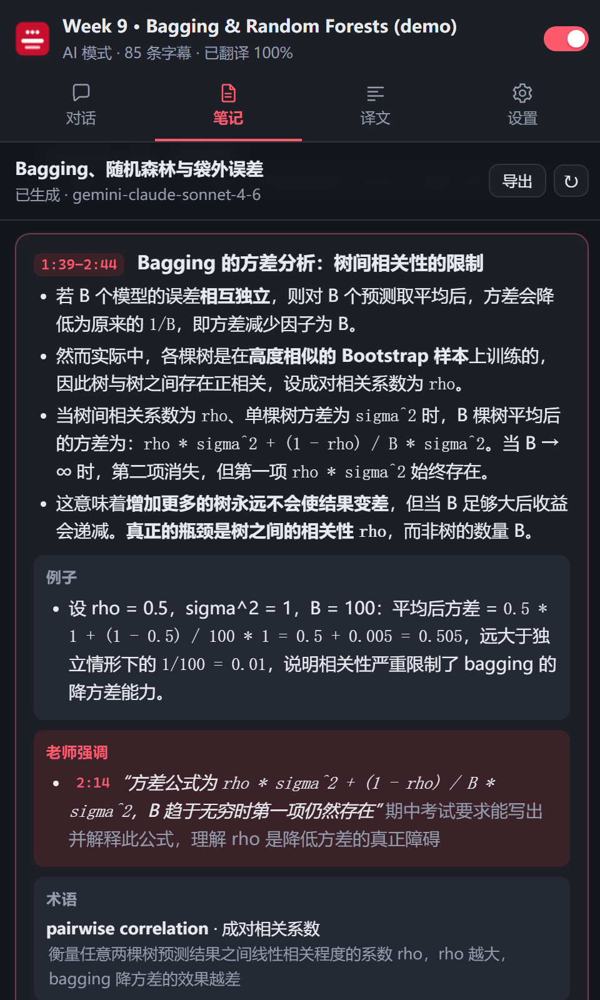
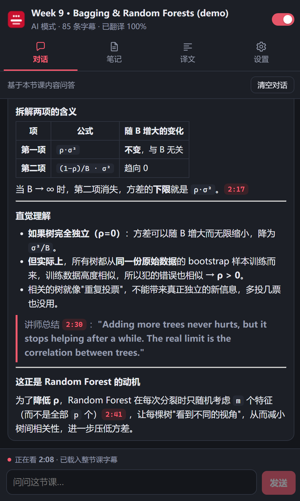
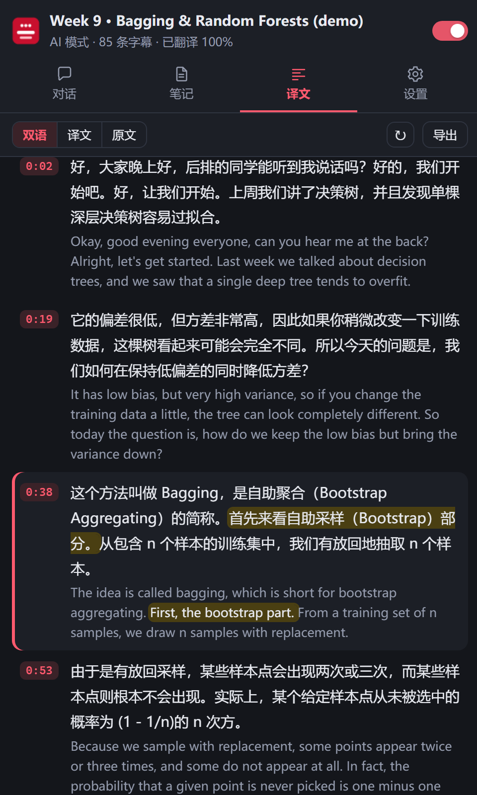
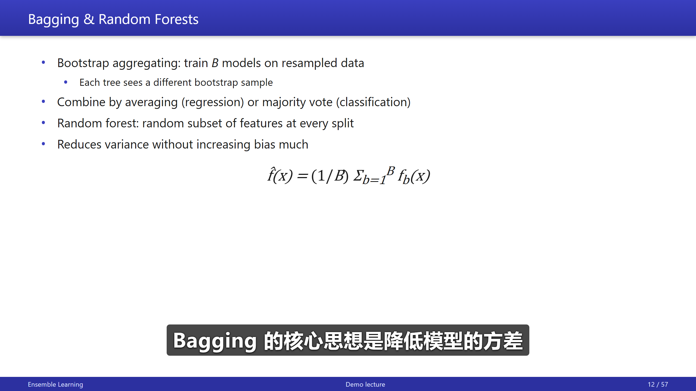
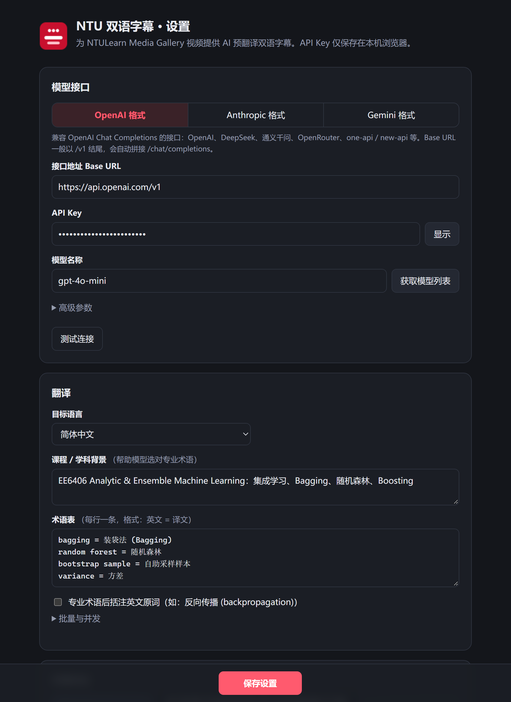

<div align="center">


# NTULearn 双语字幕

**为 NTULearn Media Gallery（Kaltura）课程视频生成双语字幕，并在侧边栏提供逐段译文、AI 课堂笔记和课程问答**

装好即用（免配置）· 可接入大模型精准翻译专业术语 · 整片预翻译无延迟

[](https://github.com/Alan1112223331/ntulearn-bilingual-subtitles/releases/latest)

[](LICENSE)



<sub>截图为本地演示页面（模拟讲座），笔记、对话和译文均为真实模型输出；已在 NTULearn 真实课程视频上验证。</sub>

</div>

---

## ✨ 功能

- **两种翻译引擎，按需选择**
  - **基础模式（默认，免配置）**：使用 Google 翻译，安装后打开视频就有双语字幕，不需要任何 API Key
  - **AI 精准模式（推荐）**：接入你自己的大模型，结合上下文、*课程背景* 和 *术语表* 翻译，提示词针对语音识别字幕（断句、识别错误）专门优化，专业名词明显更准确
- **无延迟**：拿到字幕后立即从当前播放位置开始并发预翻译**整部视频**；拖动进度条时自动优先翻译新位置；结果按视频缓存在本地，重复观看即时显示
- **AI 接口完全自定义**：OpenAI Chat Completions、Anthropic Messages、Gemini generateContent 三种格式，Base URL / API Key / 模型名均可自定义，兼容 DeepSeek、通义千问、OpenRouter、one-api / new-api 等中转
- **清晰的双语显示**：自绘字幕层随视频逐帧同步，字号随播放器尺寸自适应；支持全屏、鼠标拖动调整位置、隐藏播放器原字幕；双语 / 仅译文 / 仅原文三种模式
- **侧边栏**：点击扩展图标打开，四个页面随时切换，都会跟着视频播放位置走
  - **译文**：整节课按段落排版，当前这句高亮并自动滚动；点任意一句跳到视频对应位置；导出双语 SRT / 文稿
  - **笔记**（AI 模式）：根据整节课字幕自动生成按知识点组织的笔记，每个知识点有要点、例子、老师强调（带时间戳）、术语和"非课堂原话"的补充说明，最后附本节概览和自测题；正在讲的知识点会高亮并自动滚动到位；可导出 Markdown / 网页
  - **对话**（AI 模式）：像普通 AI 对话一样提问，AI 知道整节课的内容和你正在看的位置，回答里引用的时间点可以点击跳转
  - **设置**：就是完整的设置页
- 快捷键：`Alt+Shift+S` 开关视频字幕，`Alt+Shift+M` 切换显示模式

<table>
<tr>
<td width="33%"><p align="center"><sub>笔记：跟随播放高亮当前知识点</sub></p></td>
<td width="33%"><p align="center"><sub>对话：结合课程内容和当前位置回答</sub></p></td>
<td width="33%"><p align="center"><sub>译文：段落排版，高亮当前这句</sub></p></td>
</tr>
</table>

<p align="center"><br><sub>视频上的"仅译文"模式</sub></p>

## 📦 安装

1. 到 [Releases](https://github.com/Alan1112223331/ntulearn-bilingual-subtitles/releases/latest) 下载 `ntulearn-bilingual-subtitles-v*.zip` 并**解压**（或直接 `git clone` 本仓库）
2. 打开 `chrome://extensions`（Edge 为 `edge://extensions`），打开右上角 **开发者模式**
3. 点击 **加载已解压的扩展程序**，选择解压出的文件夹（里面有 `manifest.json`）
4. 完成！打开任意 Media Gallery 视频即可看到双语字幕（默认基础模式，无需配置）

> 需要 Chrome / Edge 116 及以上（侧边栏功能所需）。更新时下载新版本覆盖文件夹，再在扩展页点一下刷新按钮即可。

## ⚙️ 翻译引擎



点击扩展图标打开侧边栏 → **设置**，在 **翻译引擎** 里选择：

| | 基础模式 | AI 精准模式 |
| --- | --- | --- |
| 配置 | 无需配置 | 需要 API Key |
| 费用 | 免费 | 取决于你用的模型 |
| 专业术语 | 一般，偶尔不准 | 准确，支持课程背景与术语表 |
| 上下文理解 | 逐句翻译 | 结合前后文，能修正识别错误 |
| 速度 | 很快（一节 3 小时的课十几秒译完） | 视模型而定，正在看的部分优先 |
| 侧边栏译文 | ✅ | ✅ |
| 侧边栏笔记、对话 | — | ✅ |

### AI 精准模式配置

选择接口格式并填写：

| 格式 | Base URL 示例 | 实际请求地址 |
| --- | --- | --- |
| OpenAI | `https://api.openai.com/v1` | `…/chat/completions` |
| Anthropic | `https://api.anthropic.com` | `…/v1/messages` |
| Gemini | `https://generativelanguage.googleapis.com/v1beta` | `…/models/{模型}:generateContent` |

- **获取模型列表**：从接口拉取可用模型，也可直接手输模型名
- **测试连接**：翻译一段示例字幕，验证接口和输出格式
- 保存时浏览器会请求该接口域名的访问权限，请点 **允许**
- **高级参数**：Temperature（推理模型请留空）、额外请求头、额外请求体（JSON，深度合并进请求，例如 `{"reasoning_effort":"low"}`）
- 建议选速度快的非推理模型；填写 **课程/学科背景**（如 “EE6406 集成学习”）和 **术语表**（每行 `英文 = 译文`），专业名词更准确

<br clear="right">

## ▶️ 使用

打开 NTULearn 课程 → **Books & Tools → Media Gallery** → 播放任意视频，双语字幕会自动出现，左上角会短暂显示翻译进度。

- **点击扩展图标打开侧边栏**：顶部显示课程标题和翻译进度，右上角开关控制视频上的字幕
- 笔记在第一次打开"笔记"页时开始生成（从你正在看的那一段开始，边生成边显示），生成后保存在本地，下次直接显示；"对话"记录也按视频保存
- 侧边栏自动滚动时，如果你手动滚动阅读，会暂停跟随，点"回到当前位置"即可恢复
- 视频上的字幕框可以直接用鼠标 **拖动** 调整高度
- 快捷键可在 `chrome://extensions/shortcuts` 修改

> 关于用量：对话会把整节课字幕（3 小时的课约 4 万 token）作为上下文一起发送，很长的课会改为发送当前位置前后约 10 分钟的字幕和笔记大纲；笔记按约 6 分钟一段生成，一节 3 小时的课约 30 次请求。

## 🔧 工作原理

```
NTULearn (Blackboard Ultra)
└─ LTI iframe → Kaltura KAF
   └─ Kaltura PlayKit 播放器              ← 扩展在这一层工作
      ├─ inject.js   页面主环境：监听播放器的 fetch / XHR，截获字幕
      └─ content.js  隔离环境：解析字幕 → 调度翻译 → 绘制双语字幕层
            ├─ background.js  调用 Google 翻译（基础模式）或大模型 API（AI 模式，Key 不暴露给网页）
            └─ 侧边栏          通过端口实时接收字幕、译文和播放进度，发送跳转指令
```

**字幕获取**（按优先级）：

1. 截获播放器下载的字幕文件。NTU 的 Kaltura 把字幕切成 5 分钟一段的 WebVTT（`…/segmentDuration/300/…/segmentIndex/N.vtt`），播放器只加载当前附近的分段；扩展截获第一段后会按视频时长**主动拉取全部分段**，从而整片预翻译
2. 播放器 CC 关闭时，根据截获的字幕资源列表主动拉取英文字幕
3. `<video>` 的 `textTracks`
4. 兜底：读取播放器渲染的字幕文字逐句实时翻译（约 1 秒延迟）

**翻译调度**：基础模式每批最多 80 条；AI 模式每批 30 条（观众正在看的那批只取 8 条，尽快返回），附带前后各 4 条上下文，默认 3 并发；失败自动重试退避，鉴权等致命错误会暂停并提示。

## 🗂️ 目录结构

```
manifest.json
src/
  shared.js       默认设置、哈希、设置读写
  inject.js       MAIN world：网络截获字幕、预取分段
  parsers.js      SRT / WebVTT / TTML(DFXP) 解析
  content.js      字幕源选择、翻译调度、缓存、字幕层渲染
  llm.js          三种 API 格式的共享客户端（流式输出、多轮对话、JSON 修复）
  background.js   字幕翻译提示词与结果解析、Google 翻译、缓存 LRU
sidepanel/        侧边栏：panel.js 连接与状态，transcript / notes / chat 三个页面，md.js 安全的 Markdown 渲染
options/          设置页（也嵌入在侧边栏的"设置"页）
icons/
test/             本地调试页面（用桩 chrome API 加载真实内容脚本）
docs/images/      README 截图
```

## 🧪 本地调试

```bash
python -m http.server 8765
```

- `http://localhost:8765/test/harness.html`：模拟播放器 + 完整字幕文件
- `http://localhost:8765/test/harness.html?seg=1`：模拟 NTU 的分段字幕
- `http://localhost:8765/test/demo.html`：README 截图用的演示页
- 侧边栏测试台：先运行 `python test/make_harness.py`，再打开 `http://localhost:8765/test/panel-harness.html?lecture&demo`（左边模拟播放器，右边真实侧边栏，大模型由本地假接口应答）

在真实视频页按 `F12` 打开控制台，过滤 `NTU双语字幕`，可看到检测到的视频、截获的字幕、预取分段、缓存命中和翻译错误。

## 🌐 适配其它学校 / 域名

默认匹配 `https://*.kaltura.com/*` 与 `https://*.ntu.edu.sg/*`。其他使用 Kaltura 的学校，把播放器所在域名加入 `manifest.json` 的 `host_permissions` 和两个 `content_scripts.matches`，重新加载扩展即可。

## 🔒 隐私

- API Key 与设置只保存在本机 `chrome.storage.local`，不会同步、不会上传
- 基础模式：字幕文本会发送到 Google 翻译（translate.googleapis.com）
- AI 模式：字幕文本（以及页面标题作为翻译上下文）只会发送给**你自己配置的**模型接口；使用侧边栏的笔记和对话时，会把整节课的字幕和你的问题发送给该接口
- 译文、笔记和对话记录只保存在本机，可在设置页一键清空
- 扩展不收集任何数据，没有任何统计或第三方服务

## ⚠️ 免责声明

本项目为个人开源工具，与南洋理工大学（NTU）、Kaltura、Blackboard、Google 及各模型服务商均无关联。基础模式使用的是 Google 翻译的公开免费接口，不保证长期可用；若失效请切换到 AI 精准模式。课程视频与字幕的版权归其所有者，请仅用于个人学习。

## 📄 License

[MIT](LICENSE)
